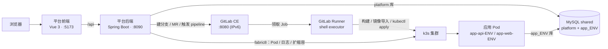

# 工程平台

一个可以完全跑在本机的交付平台：把「需求 → 开发分支 → CR → dev / test / uat / prod → 发布归档 / 回滚」串成一条可观察的流水线。真实联调时由平台驱动 GitLab CE、GitLab Runner 和 k3s；也可以切到 mock 模式，只做前端演示。

适合用来学习：Git 分支与环境分支、CI/CD、k3s 部署、滚动更新、发布门禁、回滚设计。

## 它能做什么

- **需求与分支**：每条需求只属于一个应用（`app-api` 或 `app-web`），从 `main` 创建日期前缀分支，或绑定已有分支。
- **四环境门禁**：dev → test → uat → prod 逐级解锁；上一环境成功、且 SHA 与分支最新提交一致才放行。
- **CR 审批**：test 首次部署前必须由 CR 管理员审批，提交人不能审批自己的需求；审批通过后自动发起 test 部署。
- **真实部署**：平台触发 GitLab pipeline，Runner 在 WSL 里构建镜像并部署到 k3s，平台轮询 job 回写五步进度。
- **发布档案**：prod 成功后自动写发布历史并把需求归档，归档需求从所有环境的部署列表消失。
- **任意版本回滚**：在 prod 页选择历史版本，以该版本 SHA 重跑 prod 流水线，不合并代码，历史全部保留。
- **运行时观察**：Pod 状态、日志、YAML、Events、扩缩容与重启；按应用和环境隔离命名空间。

## 架构



所有组件都在本机：Windows 上跑平台前后端，WSL2 里跑 Docker（GitLab CE）、Runner 和 k3s。更细的组件职责、端口和部署时序见 [`docs/architecture.md`](docs/architecture.md)。

## 一次发布怎么走


规则细节、状态机和回滚语义见 [`docs/workflow.md`](docs/workflow.md)。

## 仓库结构

```
engineering-platform/
├─ README.md                 入口说明（本文件）
├─ docs/                     架构、流程、数据模型、排错
├─ platform/
│  ├─ server/                Spring Boot 平台后端
│  ├─ web/                   Vue 3 平台前端
│  ├─ prototype/             已确认的静态原型
│  └─ docs/                  旧版架构图与 GitLab 仓库 CI 模板
├─ infra/
│  ├─ M0-SETUP.md            本地基础设施搭建
│  ├─ k8s/                  MySQL 与命名空间清单
│  └─ wsl/                  Windows ↔ WSL 端口转发单元
├─ app-api/                  后端应用仓库（本地克隆，不纳入本仓库）
└─ app-web/                  前端应用仓库（本地克隆，不纳入本仓库）
```

`app-api/`、`app-web/` 分别对应 GitLab 的 `root/app-api`、`root/app-web`，各自有 `main/dev/test/uat` 与需求分支。

## 快速开始

### 1. 本地基础设施

先按 [`infra/M0-SETUP.md`](infra/M0-SETUP.md) 准备 WSL2、Docker、GitLab CE、Runner、k3s 和 MySQL。已经装好可跳过。

关键端口：

| 地址 | 用途 |
|---|---|
| `http://localhost:5173` | 平台前端 |
| `http://localhost:8090` | 平台后端 API |
| `http://[::1]:8080` | GitLab（IPv4 8080 可能被其他程序占用） |
| `https://127.0.0.1:6443` | k3s API |
| `localhost:30306`（WSL 内） | MySQL NodePort |
| `localhost:3306`（Windows） | MySQL 经 socat 转发 |
| `localhost:30081` ~ `30084` | 应用 web 的 dev / test / uat / prod |

### 2. 后端

```bash
cd platform/server

# 真实 GitLab 模式（推荐）
export PLATFORM_GIT_MODE=gitlab
export GITLAB_TOKEN=<你的 GitLab PAT>
export GITLAB_URL='http://[::1]:8080'

mvn spring-boot:run
```

本机如未把 Maven / JDK 加入 PATH，用绝对路径：

```bash
JAVA_HOME=D:/develop/Java/jdk-17 \
  D:/develop/apache-maven-3.10.0/bin/mvn spring-boot:run
```

启动时会自动执行 `schema.sql`、`data.sql`（幂等），默认端口 `8090`。

> 只启动后端、不设 `PLATFORM_GIT_MODE=gitlab` 时会回退到 mock：五步流水线是 1.5 秒/步的模拟，不会触发 GitLab。

### 3. 前端

```bash
cd platform/web
npm install
npm run dev
```

打开 `http://localhost:5173`，Vite 会把 `/api` 代理到 `8090`。

### 演示账号

| 账号 | 密码 | 角色 |
|---|---|---|
| `devuser` | `123456` | 开发 |
| `zhanggong` | `123456` | CR 管理员 |
| `ligong` | `123456` | CR 管理员 |

## 两种运行模式

| 配置 | 可选值 | 说明 |
|---|---|---|
| `platform.git.mode` | `mock` / `gitlab` | Git 与流水线：模拟分支/SHA，还是真实调用 GitLab |
| `platform.runtime.mode` | `mock` / `k3s` | Pod 数据来源：演示数据，还是 fabric8 直连集群 |

两组配置互相独立。例如 `git=gitlab + runtime=k3s` 是完整的真实链路；`git=mock + runtime=mock` 只需要 MySQL 就能演示页面。

## 文档

- [文档导航](docs/README.md)：按学习顺序阅读
- [本地基础设施搭建](infra/M0-SETUP.md)：WSL2、Docker、GitLab、Runner、k3s、MySQL
- [架构说明](docs/architecture.md)：组件职责、部署时序、网络与端口
- [发布流程与门禁](docs/workflow.md)：需求状态机、CR、归档、回滚
- [数据模型](docs/data-model.md)：核心表、ER 图、发布历史三张表
- [常见问题](docs/troubleshooting.md)：环境、网络、流水线、部署排查
- [平台模块说明](platform/README.md)：后端/前端结构、配置、API

## 安全与边界

- 仓库里的密码、Token 都是本地演示占位值，**不能用于任何真实环境**。
- 平台目前只面向单机学习：MySQL 单实例、Runner 以 root 运行、平台用管理员 kubeconfig 访问集群。
- 生产化需要：独立数据库、最小权限 ServiceAccount、HTTPS、密钥管理、多副本平台服务。

## 许可

仅用于学习与内部演示。
