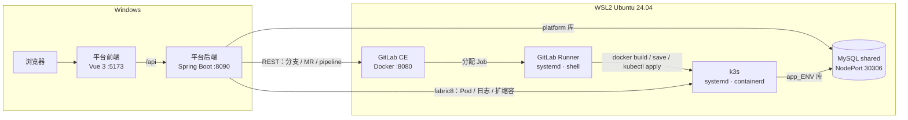
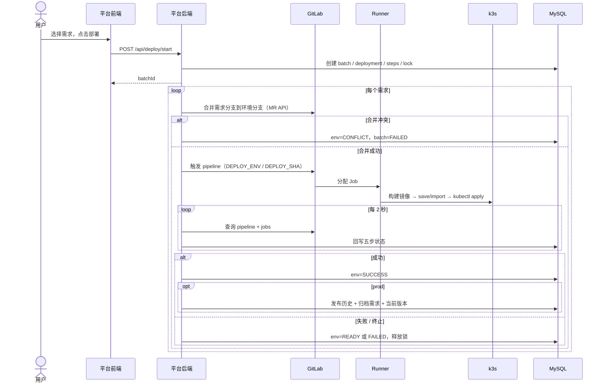
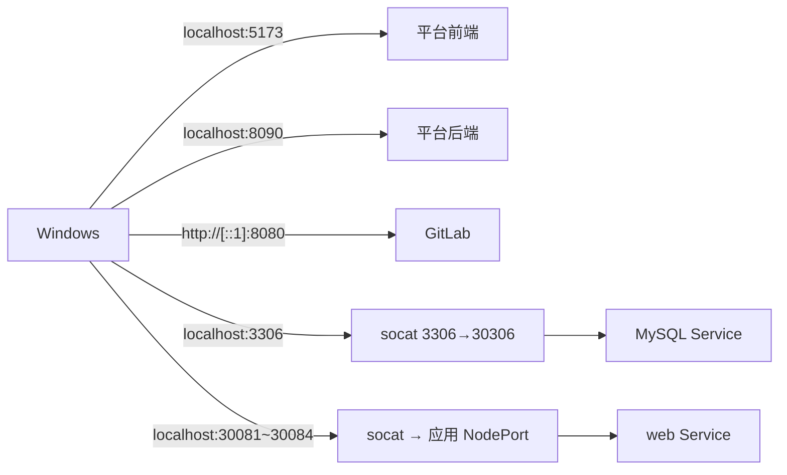

# 架构说明

## 总览

平台是「控制面」，GitLab/Runner/k3s 是「执行面」：

## 组件职责

| 组件 | 职责 | 不负责 |
|---|---|---|
| 平台前端 | 需求、部署、审批、Pod 面板 | 不直接调 GitLab / k8s |
| 平台后端 | 规则、门禁、编排、状态落库、运行时代理 | 不构建业务代码 |
| GitLab | 仓库、分支、MR、pipeline 定义 | 不主动推状态给平台 |
| GitLab Runner | 拉代码、构建、镜像导入、`kubectl apply` | 不决定部署顺序 |
| k3s | 运行 Pod、滚动更新、扩缩容、自愈 | 不感知需求和环境门禁 |
| MySQL | 平台业务数据 + 各环境应用库 | 不做业务逻辑 |

平台不接收 GitLab webhook，而是**主动轮询** pipeline 和 jobs。Runner 也是向 GitLab 长轮询领取任务，GitLab 不会反向连 Runner。

## 一次部署的时序

## 双仓库与双应用

前后端是两个独立 GitLab 仓库，也是两个独立运行时应用：

| 平台项目 | 服务 | GitLab | 命名空间 | web 端口 |
|---|---|---|---|---|
| `app-api` | `api` | `root/app-api`（id 5） | `app-api-<env>` | — |
| `app-web` | `web` | `root/app-web`（id 6） | `app-web-<env>` | 30081~30084 |

- 每个仓库都有 `main / dev / test / uat`，需求分支同名创建。
- 分支 tip 存在 `requirement_branches(requirement_id, service, branch_name, tip_sha)`，SHA 门禁按 service 比较。
- web 的 nginx upstream 是 `api.<API_NAMESPACE>.svc.cluster.local:8080`，跨命名空间访问 api；api 不存在时 web 仍能启动，只是 `/api` 返回 502。

## 网络与端口

为什么需要 socat：

- WSL2 的 `localhost` 转发只桥接**真实监听进程**。
- NodePort 由 kube-proxy 的 iptables 规则实现，WSL 内没有监听 socket，Windows 直接连 `localhost:30306/30081` 会失败。
- WSL 内起 systemd socat 监听，Windows 才能访问。单元文件在 `infra/wsl/`。

GitLab 的 IPv4 `:8080` 可能被 Steam 的调试端口占用，所以平台默认使用 `http://[::1]:8080`。

## 镜像交付

不使用镜像仓库：

1. Runner 在宿主机 `docker build`。
2. `docker save app/api:<tag> | sudo k3s ctr images import -`。
3. Deployment 使用 `imagePullPolicy: IfNotPresent`。

Docker Engine 与 k3s 使用两套镜像存储（Docker 的 overlay2 vs k3s 的 containerd），所以必须显式搬运。基础镜像（`app/api-base:17-jre`、`app/web-base:nginx`）用 debootstrap 预构建，避免依赖 Docker Hub。

## 模式开关

| 配置 | 值 | 影响 |
|---|---|---|
| `platform.git.mode` | `mock` | 平台自己推进五步，不访问 GitLab |
| | `gitlab` | 真实建分支 / MR / pipeline / cancel |
| `platform.runtime.mode` | `mock` | Pod 面板是演示数据 |
| | `k3s` | fabric8 读写真实集群 |

两组开关独立。真实链路是 `gitlab + k3s`；只做页面演示可以用 `mock + mock`。
