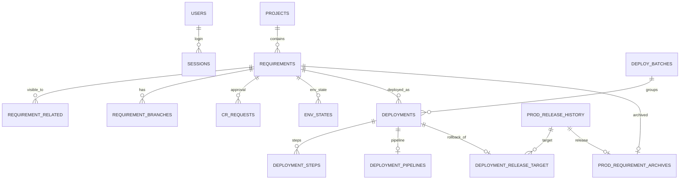

# 数据模型

## ER 图



## 表分组

### 账号与项目

| 表 | 说明 |
|---|---|
| `users` | 账号、显示名、角色（`DEV` / `CR_ADMIN`）、密码哈希 |
| `sessions` | 登录 token（UUID），7 天过期 |
| `projects` | 平台项目；`service` 限制仓库类型，`runtime_app` 拼 k3s 命名空间 |

### 需求与分支

| 表 | 说明 |
|---|---|
| `requirements` | 需求主表；`req_no` 在项目内唯一；`branch_status` 表示是否已建分支 |
| `requirement_related` | 需求可见性：owner 之外的相关人 |
| `requirement_branches` | 每个需求 × service 的分支名与最新 tip SHA |
| `cr_requests` | test 首次部署的 CR；每个需求 × service 一条 |

`requirements.tip_sha` 是旧版单仓库字段；双仓后以 `requirement_branches.tip_sha` 为准。

### 部署台账

| 表 | 说明 |
|---|---|
| `env_states` | 每个需求 × service × env 的当前状态、SHA、操作人、错误信息 |
| `deploy_batches` | 一次批量部署（可包含多个需求） |
| `deployments` | 单个需求的部署记录，关联 batch |
| `deployment_steps` | 五步进度与耗时 |
| `deploy_locks` | 环境锁，主键 `(project_id, service, env)` |
| `deployment_pipelines` | 平台部署 → GitLab pipeline id 的映射 |

### 生产发布

| 表 | 说明 |
|---|---|
| `prod_release_history` | 全部 prod 发布历史；`is_current=1` 表示当前版本 |
| `prod_requirement_archives` | 已归档需求，主键 `requirement_id` |
| `deployment_release_target` | 回滚部署 → 目标发布版本的映射 |
| `prod_releases` | 旧版单版本回滚表，已不再读写，保留只读 |

## 发布相关表的关键设计

### `prod_release_history`

```sql
UNIQUE KEY uk_rel_current (project_id, service, is_current)
```

- 每个 `(project_id, service)` 只能有一条当前版本。
- 非当前版本 `is_current = NULL`；MySQL 唯一索引允许多个 `NULL`。
- 冗余保存 `req_no / title / branch_name / operator`，历史不依赖需求表当前状态。
- `released_at` 首次发布时间；同一 SHA 重复发布只更新这一行，不新增历史。

### `prod_requirement_archives`

- `requirement_id` 为主键，`INSERT IGNORE` 保证重复归档幂等。
- 部署页查询时先取该项目已归档 ID 集合，再过滤所有环境的需求。

### `deployment_release_target`

- 只有回滚部署才写这一行。
- 流水线执行时按 `deployment_id` 查目标版本：查到就走「跳过合并、用历史 SHA」的回滚路径。

## 约定

- 所有 SHA 都是 7 位短 SHA（`CHAR(7)`）。
- 时间统一 `DATETIME`，应用侧使用 `LocalDateTime`。
- `schema.sql` 每次启动执行，只允许 `CREATE TABLE IF NOT EXISTS`；不要给旧表加列。
- 不使用 Flyway；结构性变更用一次性 SQL 手工执行。
- `data.sql` 只放账号和项目，业务数据从空白开始。
