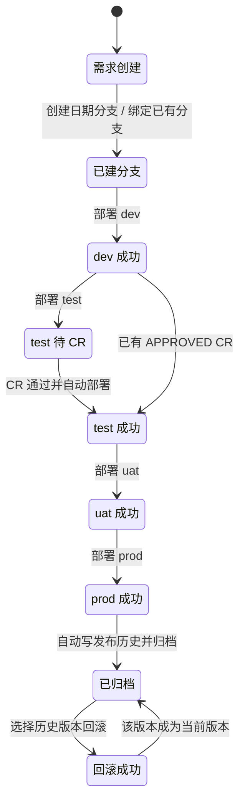
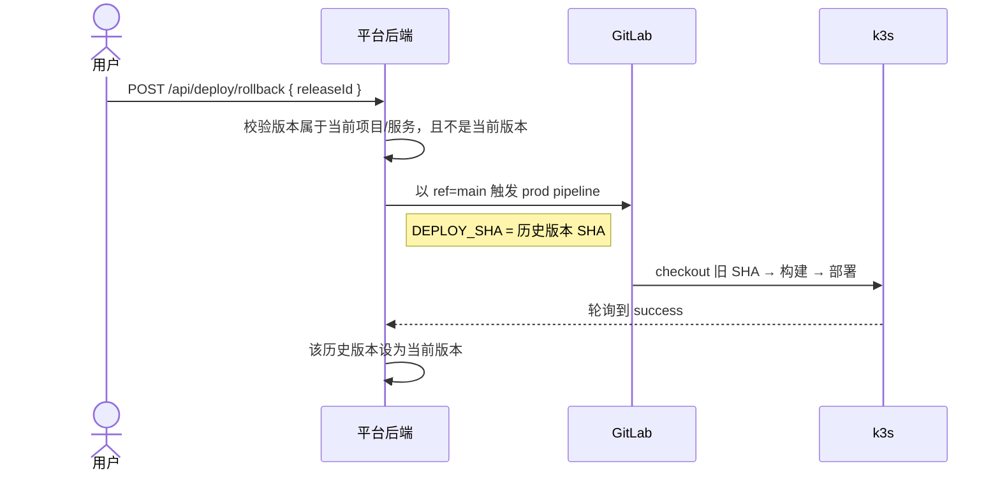

# 发布流程与门禁

## 生命周期

## 门禁规则

| 环境 | 前置条件 |
|---|---|
| dev | 需求有开发分支 |
| test | dev 成功；SHA 与分支最新 tip 一致；test 首次部署需要 `APPROVED` CR |
| uat | test 成功；SHA 与 tip 一致 |
| prod | uat 成功；SHA 与 tip 一致；合并目标为 `main` |

补充：

- **SHA 一致**：上一环境部署的提交必须等于该 service 分支当前 tip。有人 push 新提交后，上一环境就会显示「有新提交」，需要先重新部署上一环境。
- **CR**：提交人不能审批自己的需求；只有 `CR_ADMIN` 能审批。审批通过后平台自动发起一次 test 部署，不需要再点部署。
- **串行**：同一 `project + service + env` 用 `deploy_locks` 串行，不同环境可并行。
- **不锁页面**：某环境在部署时，其他人仍可切换到别的环境或项目操作。

## 合并与冲突

平台在触发 pipeline 前，先把需求分支合并到目标环境分支：

- `dev / test / uat` 合并到同名分支，`prod` 合并到 `main`。
- 合并通过 GitLab MR API；无差异时跳过。
- 有冲突：环境状态置 `CONFLICT`，不触发流水线，MR 留在 GitLab 等待解决；页面点「已解决」只把状态置回 `READY`，真正的代码冲突仍需人工合并。

## 发布归档

prod 流水线成功后，平台在**同一事务**里完成：

1. 部署状态 `SUCCESS`
2. 环境状态 `SUCCESS`
3. 写 `prod_release_history`
4. 设置该版本为当前版本（`is_current=1`）
5. 写 `prod_requirement_archives`

效果：

- 需求从 dev / test / uat / prod 所有「已部署 / 待部署」列表消失。
- 需求管理页仍能看到，状态为「已上线」，并显示「已发布」。
- 该需求不能再发起普通部署（接口会拒绝），但可以作为历史版本被回滚。

规则：

- 每个 `(project, service)` 只有一条当前版本；数据库用唯一键兜底。
- 同一 SHA 重复发布只更新当前行的发布时间，不新增重复历史。
- 历史全部保留，不做清理。
- 功能上线前已经成功的旧部署不会自动归档；需要重新发布一次，或手工写入归档数据。

## 回滚

回滚不是 Git revert，也不合并代码：

特点：

- **不合并**：跳过 merge，直接使用历史 SHA 重跑 prod 流水线。
- **历史不变**：不新增、不删除历史行，只切换 `is_current`。
- **可逆**：回滚到 A 之后，还可以再回滚到 B。
- **当前版本拒绝**：对当前版本发起回滚返回 400。
- **归档需求允许回滚**：归档只限制普通部署。

前提：历史 SHA 必须仍能在仓库中 checkout。CI 依赖 `DEPLOY_SHA`，如果旧提交已被删除或 CI 契约已不兼容，回滚流水线会失败，历史与当前版本保持不变。

## 失败与终止

| 结果 | 部署 | 环境 | 批次 | 后续 |
|---|---|---|---|---|
| 流水线失败 | `FAILED` | 回 `READY` | `FAILED` | 可重试 |
| 合并冲突 | `FAILED` | `CONFLICT` | `FAILED` | 人工解决后点「已解决」 |
| 用户终止 | `CANCELLED` | 回 `READY` | `TERMINATED` | 可重新部署 |
| 服务重启 | `CANCELLED` | 回 `READY` | `TERMINATED` | 启动时自动清理残留 |
| 成功 | `SUCCESS` | `SUCCESS` | `SUCCESS` | prod 触发归档 |

## 并发与一致性

- 部署锁：`deploy_locks(project_id, service, env)` 唯一键，重复提交返回 409。
- 当前版本：`prod_release_history` 的唯一键 `(project_id, service, is_current)`，非当前版本 `is_current=NULL`（MySQL 唯一索引允许多个 NULL）。
- 归档：`prod_requirement_archives.requirement_id` 主键，`INSERT IGNORE` 保证幂等。
- 平台重启：`reconcileAfterRestart` 把残留的 RUNNING 部署/步骤/批次清成终止态并释放锁，不会把「部署中」永久留在页面上。
