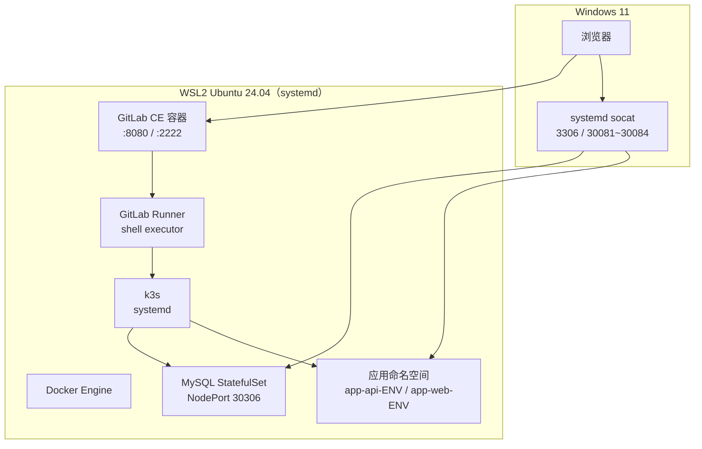

# 本地基础设施搭建

目标：在一台 Windows 电脑上，用 WSL2 跑通 GitLab → Runner → k3s 的完整部署链路，不装 Docker Desktop。

## 拓扑



约定：

- PowerShell 命令在 Windows 执行。
- `bash` 命令在 WSL 发行版里执行，需要时加 `sudo`。
- 数据都放在 WSL 虚拟磁盘（D 盘），不占 C 盘。

## 1. WSL2

要求 Windows 11、已开启虚拟化，D 盘预留 40GB 以上。

```powershell
wsl --update
wsl --install -d Ubuntu-24.04
```

安装后确认 systemd：

```bash
systemctl is-system-running     # running 或 degraded
```

`.wslconfig`（`C:\Users\<用户名>\.wslconfig`）：

```ini
[wsl2]
memory=20GB
processors=8
swap=8GB
```

改完执行 `wsl --shutdown`。

> 本项目实际使用 `Ubuntu-24.04`，虚拟磁盘在 `D:\wsl\Ubuntu2404`。发行版名称和路径可以不同，后文按自己的名称替换。

## 2. Docker Engine

```bash
sudo apt-get update
sudo apt-get install -y docker.io
sudo systemctl enable --now docker
sudo usermod -aG docker "$USER"
```

退出重进 WSL（或 `newgrp docker`）后验证：

```bash
docker version
docker run --rm hello-world
```

国内网络建议配置加速器（`/etc/docker/daemon.json`）：

```json
{
  "registry-mirrors": ["<你可用的加速地址>"]
}
```

```bash
sudo systemctl restart docker
```

> 加速器可用性会变化，以当前实测为准；不要长期依赖某一个地址。

## 3. GitLab CE

```bash
docker run -d --name gitlab --restart unless-stopped --shm-size 256m \
  -p 8080:8080 -p 2222:22 \
  -v gitlab-config:/etc/gitlab \
  -v gitlab-logs:/var/log/gitlab \
  -v gitlab-data:/var/opt/gitlab \
  -e GITLAB_OMNIBUS_CONFIG="external_url 'http://localhost:8080'; puma['port'] = 8081;" \
  gitlab/gitlab-ce:latest
```

要点：

- `external_url` 用 8080 时，容器内 nginx 也监听 8080；必须把 puma 改成 8081，否则会 `EADDRINUSE` 并反复崩溃。
- 首次启动约 3~6 分钟。
- 初始 root 密码：`docker exec gitlab cat /etc/gitlab/initial_root_password`，登录后立即修改。
- Windows 访问建议用 `http://[::1]:8080`，IPv4 8080 可能被 Steam 占用。
- 创建一个 api scope 的 Personal Access Token，平台用它调用分支、MR 和 pipeline API。

## 4. k3s

```bash
curl -sfL https://get.k3s.io | \
  INSTALL_K3S_MIRROR=cn \
  INSTALL_K3S_EXEC="server --disable traefik --write-kubeconfig-mode 644" sh -

sudo systemctl enable --now k3s
kubectl get nodes -o wide
```

复制 kubeconfig 给当前用户：

```bash
mkdir -p ~/.kube
sudo cp /etc/rancher/k3s/k3s.yaml ~/.kube/config
sudo chown "$USER:$USER" ~/.kube/config
```

k3s 自带 containerd，与 Docker 的镜像存储**不互通**；镜像要用 `docker save | k3s ctr images import` 搬运。

## 5. MySQL

```bash
cd /mnt/d/develop/project/engineering-platform
kubectl apply -f infra/k8s/00-namespaces.yaml

kubectl -n shared create configmap mysql-init \
  --from-file=01-init.sql=infra/mysql-init/01-init.sql
kubectl -n shared create secret generic mysql-root \
  --from-literal=password=root_local_pw

kubectl apply -f infra/k8s/mysql.yaml
kubectl -n shared rollout status statefulset/mysql --timeout=180s
```

初始化脚本创建 5 个库：`platform`、`app_dev`、`app_test`、`app_uat`、`app_prod`，以及同名账号（账号密码见 `infra/mysql-init/01-init.sql`）。

验证：

```bash
kubectl -n shared exec statefulset/mysql -- \
  mysql -uroot -proot_local_pw -e "show databases;"
```

> 初始化脚本只在数据目录为空时执行；重置需要删除 PVC，会丢数据。

## 6. Windows ↔ WSL 端口转发

WSL2 的 localhost 转发只桥接真实监听进程；NodePort 是 kube-proxy 的 iptables 规则，Windows 直接连会失败。用 socat 在 WSL 里监听：

```bash
sudo apt-get install -y socat
sudo cp infra/wsl/mysql-nodeport-forward.service /etc/systemd/system/
sudo systemctl daemon-reload
sudo systemctl enable --now mysql-nodeport-forward.service
```

MySQL：Windows `localhost:3306` → WSL `127.0.0.1:30306`。

应用 web 的四个环境同理：在 WSL 里监听 `30081~30084`，转发到对应的 NodePort。用仓库里的模板服务：

```bash
sudo cp infra/wsl/web-nodeport-forward@.service /etc/systemd/system/
sudo systemctl daemon-reload
sudo systemctl enable --now web-nodeport-forward@30081.service
sudo systemctl enable --now web-nodeport-forward@30082.service
sudo systemctl enable --now web-nodeport-forward@30083.service
sudo systemctl enable --now web-nodeport-forward@30084.service
```

模板内容（端口通过 `%i` 传入）：

```ini
[Unit]
Description=Forward localhost:%i to NodePort %i
After=network.target

[Service]
ExecStart=/usr/bin/socat TCP-LISTEN:%i,fork,reuseaddr TCP:127.0.0.1:%i
Restart=always

[Install]
WantedBy=multi-user.target
```

## 7. GitLab Runner

安装（腾讯镜像的 apt 仓库在国内可达）：

```bash
BASE=https://mirrors.cloud.tencent.com/gitlab-runner/ubuntu
curl -s -o /tmp/packages.gz "$BASE/dists/noble/main/binary-amd64/Packages.gz"
file=$(gzip -dc /tmp/packages.gz | awk '/^Package: gitlab-runner$/{f=1} f&&/^Filename:/{print $2; exit}')
curl -L -o /tmp/gr.deb "$BASE/$file"
sudo dpkg -i /tmp/gr.deb
```

以 root 跑 shell executor（CI 需要调用 docker / kubectl / k3s）：

```bash
sudo gitlab-runner uninstall
sudo gitlab-runner install --user root --working-directory /root/gitlab-runner
sudo systemctl enable --now gitlab-runner
```

在 GitLab 页面创建实例 Runner，设置 tag `local`，复制 `glrt-` token 后注册：

```bash
sudo gitlab-runner register --non-interactive \
  --url "http://localhost:8080" \
  --token "<glrt-token>" \
  --executor "shell"
```

`/etc/gitlab-runner/config.toml` 保持最小配置：

```toml
concurrent = 2
[[runners]]
  name = "wsl-shell"
  url = "http://localhost:8080"
  token = "glrt-xxxx"
  executor = "shell"
```

注意：

- 16.10 不要留空的 `[runners.shell]` 段。
- tag 在 GitLab 服务端配置为 `local`。
- Runner 以 root 运行时，CI 里的 `sudo k3s` 不需要额外免密。若改成普通用户运行，需要：

```bash
echo "<runner-user> ALL=(root) NOPASSWD: /usr/local/bin/k3s" | \
  sudo tee /etc/sudoers.d/gitlab-runner-k3s
sudo chmod 440 /etc/sudoers.d/gitlab-runner-k3s
```

## 8. GitLab 仓库与 CI 变量

1. 建两个项目：`root/app-api`、`root/app-web`。
2. 各自推送 `main / dev / test / uat`。
3. 关闭 Auto DevOps：

```bash
curl -X PUT -H "PRIVATE-TOKEN: <PAT>" \
  "http://[::1]:8080/api/v4/projects/<id>?auto_devops_enabled=false"
```

4. 两个项目分别添加 CI 变量：

| 变量 | 值（与 init SQL 一致） |
|---|---|
| `DB_DEV_PASSWORD` | `app_dev_pw` |
| `DB_TEST_PASSWORD` | `app_test_pw` |
| `DB_UAT_PASSWORD` | `app_uat_pw` |
| `DB_PROD_PASSWORD` | `app_prod_pw` |

5. 两个仓库的 `.gitlab-ci.yml` 参考 `platform/docs/repo-templates/`；CI 的 `workflow` 只接受带 `DEPLOY_ENV` 的流水线。

## 9. 验证清单

```bash
# GitLab
curl -s -H "PRIVATE-TOKEN: <PAT>" "http://[::1]:8080/api/v4/projects" | head

# Runner
sudo gitlab-runner verify

# k3s
kubectl get nodes
kubectl -n shared get pods

# MySQL（Windows）
# 用任意 MySQL 客户端连 localhost:3306，账号 platform / platform_pw
```

然后按根目录 README 启动平台前后端。

## 10. k3s 练习清单

```bash
kubectl get nodes -o wide
kubectl -n app-api-dev get pods -o wide
kubectl -n app-api-dev describe pod <pod>
kubectl -n app-api-dev logs deploy/api --tail=50
kubectl -n app-api-dev exec -it deploy/api -- sh
kubectl -n app-api-dev scale deploy/api --replicas=3
kubectl -n app-api-dev delete pod <pod>            # 观察自愈
kubectl -n app-api-dev rollout history deploy/api
kubectl -n app-api-dev rollout undo deploy/api
kubectl -n app-api-dev port-forward svc/api 8081:8080
kubectl -n app-api-dev get endpoints
kubectl get ns
```

## 11. 常见问题

见 [`../docs/troubleshooting.md`](../docs/troubleshooting.md)。高频：

- GitLab 打不开 → 用 `[::1]:8080`。
- Runner offline → 检查 `config.toml` 和 tag。
- Windows 连不上 NodePort → 检查 socat 服务。
- pipeline 卡住 → 检查 Auto DevOps、并发数和 CI 规则。
